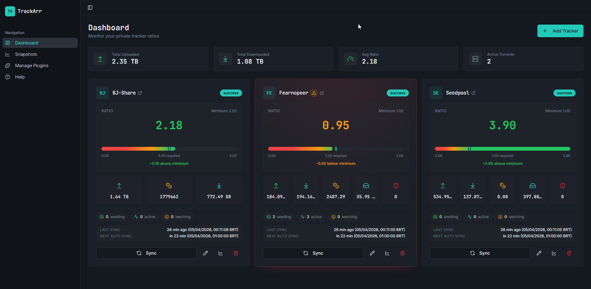
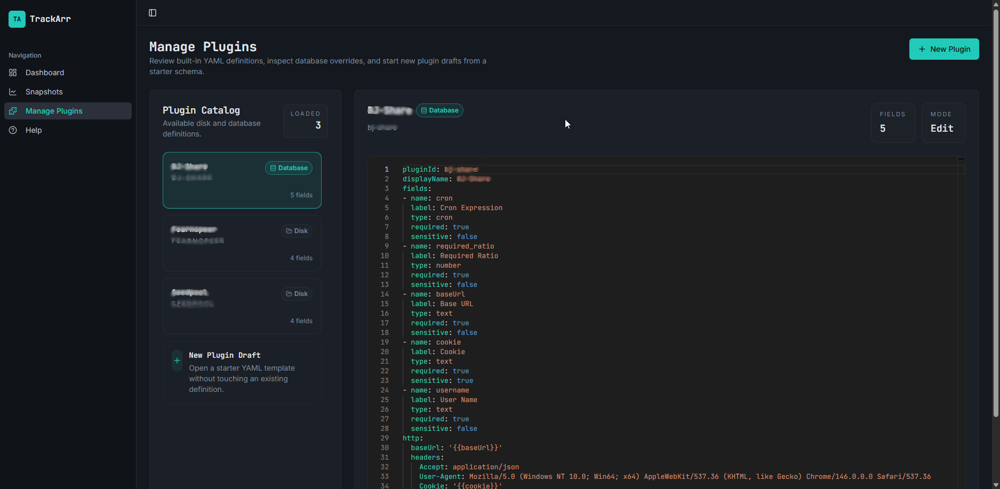
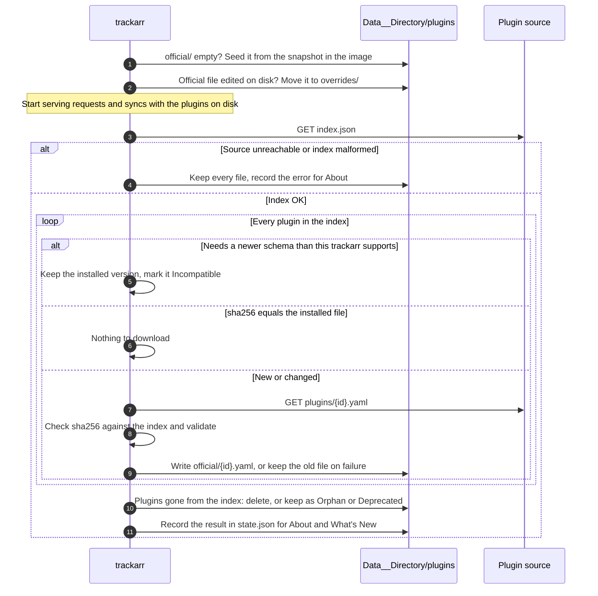
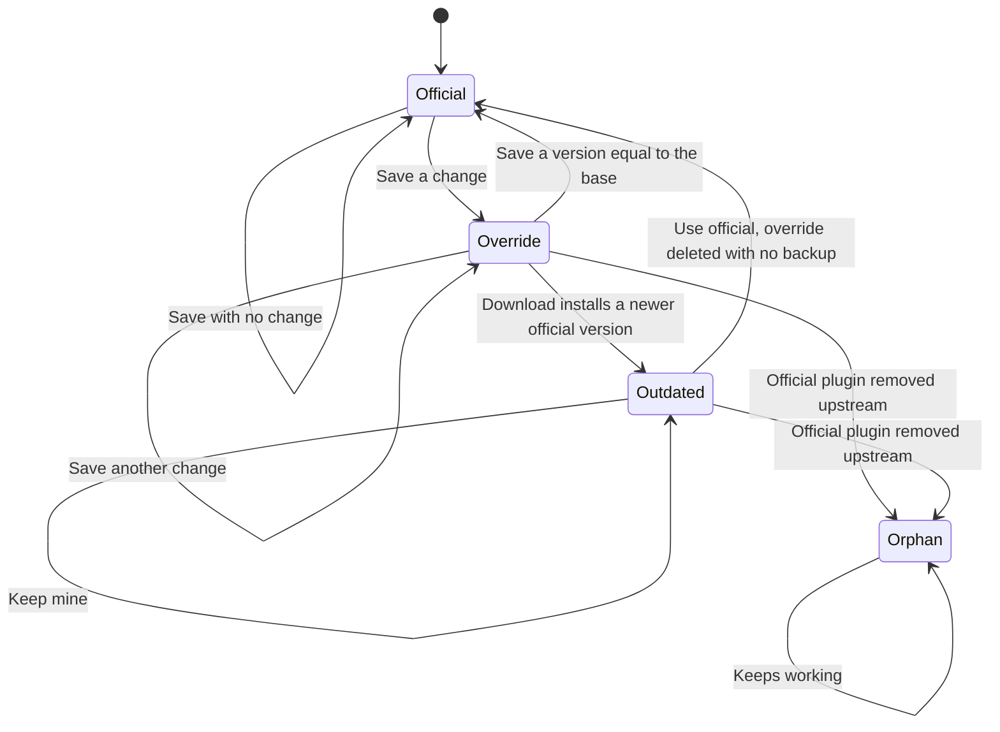
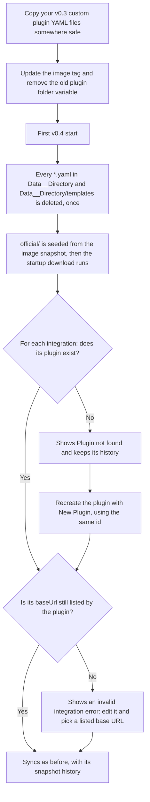

# TrackArr

| Status | Badge |
| --- | --- |
| CI pipeline | [](https://github.com/leandrobattochio/trackarr/actions/workflows/ci.yml) |
| Cypress E2E | [](https://github.com/leandrobattochio/trackarr/actions/workflows/full-stack-e2e.yml) |
| Frontend coverage (`frontend/`) | [](https://app.codecov.io/github/leandrobattochio/trackarr?flags%5B0%5D=frontend) |
| Backend coverage (`backend/`) | [](https://app.codecov.io/github/leandrobattochio/trackarr?flags%5B0%5D=backend) |

TrackArr is a self-hosted dashboard for private tracker monitoring. It lets you register tracker integrations, sync stats manually or on a schedule, keep historical snapshots, and define new tracker connectors through YAML instead of hard-coded backend logic.

## Docker Compose example

TrackArr runs as a single container. It keeps its data in a SQLite file in the data volume, so it needs no database server. A minimal `docker-compose.yml` can look like this:

```yaml
services:
  trackarr:
    image: ghcr.io/leandrobattochio/trackarr:v0.5.0
    container_name: trackarr
    restart: unless-stopped
    ports:
      - "3012:3000"
    environment:
      ASPNETCORE_ENVIRONMENT: Production
      Hangfire__Directory: /data
      Data__Directory: /data
      APP_TIMEZONE: America/Sao_Paulo
      TZ: America/Sao_Paulo
    volumes:
      - /mnt/user/appdata/trackarr:/data
```

Adjust the host volume path, published port, timezone, and image tag to fit your environment. Every setting is listed under [Configuration](#configuration). To keep the data in PostgreSQL instead, read [Using PostgreSQL](#using-postgresql).

Upgrading from v0.4 with PostgreSQL? Keep `ConnectionStrings__PostgresConnection` and your database service as they are: trackarr keeps using PostgreSQL and your data, and nothing else changes. Upgrading from v0.3? Read the [v0.4 upgrade guide](docs/upgrade-0.4.md) first: it deletes every v0.3 plugin file.

> [!WARNING]
> The trackarr API and UI have **no authentication**. Anyone who can reach the port can read and change your integrations and plugins, and a changed plugin can send your stored tracker cookies and API keys to any host. Keep trackarr on a trusted network (LAN or VPN) and never publish it to the internet. If you need remote access, put it behind a reverse proxy or VPN that authenticates users.

## What it does

- Monitors tracker ratio and transfer stats from a single dashboard
- Stores historical snapshots for time-based charts
- Runs recurring sync jobs per integration using cron expressions
- Downloads the official tracker plugins from [`trackarr-plugins`](https://github.com/leandrobattochio/trackarr-plugins) on every start, so tracker fixes arrive without a new image
- Lets you edit official plugins (your copy is kept as an override) and create custom plugins from the UI
- Includes a settings area for HTTP defaults and runtime information
- Ships as a single production container with the React frontend served by ASP.NET Core

## Core features

- Dashboard with per-tracker cards for ratio, uploaded, downloaded, seed bonus, buffer, hit and runs, and torrent counts
- Manual sync for any configured integration
- Automatic recurring sync with Hangfire-backed scheduling
- Snapshot charts for uploaded/downloaded bytes and torrent activity
- In-app YAML editor for plugin authoring with schema-aware validation, completions, snippets, and hover docs
- **Test** button that dry-runs a plugin with an existing integration's settings, without saving anything
- Outdated-override warning with side-by-side diffs, and a What's New screen with the trackarr and plugin changelogs
- Settings page for the shared `User-Agent` header and system information

## Screenshots

### Dashboard

The dashboard is the main operational view. It combines portfolio-level totals across all configured trackers with per-integration cards that surface ratio status, key metrics, last sync state, next automatic run, and quick actions for syncing, editing, opening snapshots, or deleting an integration.

The screenshot below also shows the ratio-warning treatment in context: integrations that fall below the configured minimum ratio are visually highlighted so risky trackers stand out immediately.



### Manage Plugins

The plugin-management screen is where plugin definitions are inspected, created, edited, and tested. The catalog on the left lists every plugin with its status badge (see [Plugins](#plugins)), while the editor on the right exposes the definition that drives integration forms, HTTP steps, mappings, and dashboard metrics.

Saves are blocked when the document is malformed or semantically invalid, and the editor includes TrackArr-specific validation and authoring help while you work.



## Architecture

### Frontend

- React 19
- Vite 7
- TypeScript
- TanStack Query
- Tailwind CSS + Radix UI + Monaco editor + Monaco YAML services

The frontend runs on `http://localhost:8080` in development and proxies `/api` requests to the backend on `http://localhost:5000`.

### Backend

- ASP.NET Core Web API on `.NET 10`
- Entity Framework Core with SQLite (default) or PostgreSQL
- Hangfire + `Hangfire.Storage.SQLite`
- Scalar/OpenAPI in development
- YAML plugin engine powered by `YamlDotNet`

The production container serves the API and the built frontend together on port `3000`.

## Project structure

```text
.
|-- backend/
|   |-- TrackerStats.sln
|   |-- src/
|   |   |-- TrackerStats.Api/       # API, DI, startup, controllers
|   |   |-- TrackerStats.Application/
|   |   |-- TrackerStats.Domain/    # Entities, repository interfaces, plugin contracts
|   |   `-- TrackerStats.Infrastructure/
|   |       |-- Data/               # EF Core DbContext and migrations
|   |       |-- Plugins/            # Plugin registry, YAML engine, loaders
|   |       `-- Services/           # Sync jobs and scheduling
|   `-- tools/
|       `-- TrackerStats.PluginValidator/  # CLI that validates plugin YAML files
|-- frontend/
|   |-- src/
|   |   |-- app/                    # App bootstrap and routing
|   |   |-- features/               # Integrations, plugins, help, snapshots
|   |   |-- layouts/
|   |   `-- shared/
|   `-- package.json
`-- docker/
    |-- Dockerfile
    |-- docker-compose.yml           # trackarr on SQLite
    `-- docker-compose.postgres.yml  # trackarr with a PostgreSQL container
```

## Plugins

A plugin is a YAML file that tells the engine how to log into a tracker, which requests to make, how to read the stats from the responses, and what to show on the tracker card. Every integration uses exactly one plugin, by its `pluginId`.

### Official, override and custom plugins

| Kind | Badge | Where it comes from | Stored in | Changed by |
| --- | --- | --- | --- | --- |
| **Official** | `Official v1.2.0` | The [`trackarr-plugins`](https://github.com/leandrobattochio/trackarr-plugins) repository (`asc`, `bj-share`, `fearnopeer` and `seedpool` today) | `<Data__Directory>/plugins/official/` | Only the startup download |
| **Override** | `Edited (base v1.1.0)` | Created when you save changes to an official plugin; it records the official version it was based on | `<Data__Directory>/plugins/overrides/` | Only you, from the UI. The download never touches it |
| **Custom** | `Custom v1.0.0` | Created with **New Plugin**, with an id that is not an official id | `<Data__Directory>/plugins/custom/` | Only you, from the UI. The download never touches it |

When an id has more than one file, the override wins over the custom plugin, which wins over the official one. A `state.json` file next to the three folders records the installed official versions, each override's base, and the last download result. The app reads the plugins from disk on every use, so a saved plugin takes effect immediately.

Other badges:

- **Outdated**: your override is based on an older official version than the one installed. A banner on every page links to the review screen, and it cannot be dismissed.
- **Orphan**: your override's official plugin was removed from `trackarr-plugins`. The override keeps working.
- **Deprecated**: an official plugin was removed from `trackarr-plugins`, but an integration still uses it, so the cached copy keeps working.
- **Incompatible**: a newer official version needs a newer trackarr. The app keeps the last compatible version and tells you which trackarr version to update to.
- A custom plugin whose id was later published as an official plugin keeps working and hides the official one; a notice explains it.

### Changing a plugin

Plugins are changed **only in the UI**, on the **Manage Plugins** page (`/plugins`). Editing the files on disk is not supported. As a safety net only, an official file edited on disk is detected by its sha256 and turned into an override at the next start.

- **Edit an official plugin:** select it, change the YAML, optionally click **Test**, then **Save**. Saving creates an override with the current official version as its base; the official file is never changed. Saving with no change creates nothing.
- **Go back to the official version:** edit your override until it matches the official version again and save; it is discarded automatically. When the override is outdated, the review screen also offers **Use official**, which deletes the override **with no backup**.
- **Update an outdated override:** open the review screen from the banner or the **Review update** link. It shows **What you changed** (base against yours) and **What changed upstream** (base against the new official version), the changelog, and the actions **Use official** and **Keep mine**. **Keep mine** changes nothing and the warning stays. To carry your change onto the new version, copy it from the first diff, click **Use official**, then edit the plugin again. When the last sync of an integration using your override failed, the warning is highlighted and **Test official** dry-runs the official version with that integration's settings.
- **Create a custom plugin:** click **New Plugin**, replace the `<your-plugin-id>` placeholder with an id made of lowercase letters and digits separated by single hyphens (for example `my-tracker`) that is not an official id, keep `schemaVersion: 1`, and click **Create Plugin**.
- **Delete a custom plugin:** select it and click **Delete**. It is blocked while an integration uses it; the dialog lists those integrations.
- **Test a plugin:** **Test** runs the YAML in the editor, saved or not, with the settings of an integration you pick. It saves no snapshot and does not change the integration, and shows the outcome, each step's HTTP status, the extracted stats and the first failing field.

To share a fix or publish a custom plugin as an official one, open a pull request to `trackarr-plugins` as its [`CONTRIBUTING.md`](https://github.com/leandrobattochio/trackarr-plugins/blob/main/CONTRIBUTING.md) explains.

### Startup download

On every start the app downloads the official plugins from the plugin source (`PluginSource__Url`, by default the `main` branch of `trackarr-plugins` on GitHub). It does not wait for the download: integrations sync right away with the plugins already on disk. The result (time, source, index hash, per-plugin outcome and errors) is shown in **Settings > About**, and updated plugins appear in **What's New**.



Every file is checked against the sha256 in `index.json`. Overrides and custom plugins are never written. The Docker image embeds a snapshot of `trackarr-plugins` taken at build time, so a first start without internet still has the official plugins.

### Override lifecycle



An override is a full copy of the YAML, shared by every integration of that plugin. If it becomes invalid, its integrations show an "invalid override" error and stop syncing; they do not fall back to the official version.

### Plugin YAML

TrackArr uses YAML plugin definitions to describe how to connect to a tracker:

- `pluginId`, `displayName`: the id integrations use (it must equal the file name) and the label shown in the UI
- `version`, `schemaVersion`, `changelog`: the plugin's semver version, the YAML format it uses (`1` today, required in custom plugins) and its release notes
- `fields`: form inputs required to configure an integration
- `customFields`: optional tracker-specific inputs beyond the shared integration fields
- `http`: shared base URL and headers
- `steps`: HTTP requests and extraction rules
- `mapping`: how extracted values map into TrackArr stats
- `dashboard`: which stats should be shown on the UI card, including optional `byteUnitSystem` for binary vs decimal byte formatting

The frontend plugin editor validates more than generic YAML syntax. It understands the TrackArr plugin structure, shows completions for supported fields and enums, offers snippets for common blocks, and blocks saves when the document is malformed or semantically invalid. The full schema is documented in the `trackarr-plugins` [`CONTRIBUTING.md`](https://github.com/leandrobattochio/trackarr-plugins/blob/main/CONTRIBUTING.md).

To validate plugin files outside the app, with the same rules the API applies on save (schema, `pluginId` format, engine-owned fields, `version` and `schemaVersion`), run from the repository root:

```bash
dotnet run --project backend/tools/TrackerStats.PluginValidator -- path/to/*.yaml
```

It prints one line per file and exits non-zero when any file is invalid. Each file name must equal its `pluginId`.

## Local development

### Requirements

- Node.js 22+
- pnpm
- .NET SDK 10

### Local development config

`appsettings.Development.json` is intentionally untracked. If you want local development defaults, create `backend/src/TrackerStats.Api/appsettings.Development.json` on your machine.

Example:

```json
{
  "Data": {
    "Directory": "../../.data"
  }
}
```

Notes:

- Keep this file local only. Do not commit machine-specific or secret values.
- Use environment variables instead when you want settings that also work in CI or Docker.
- Set `Data:Directory` to a writable local folder; `../../.data` resolves to `backend/.data`. Plugins are read from `<Data:Directory>/plugins/official`, `overrides` and `custom`; on start, the app downloads the official plugins from `trackarr-plugins`. To work offline, set `PluginSource:Url` to the test fixture, `file:///<repo>/backend/tests/fixtures/plugin-source/`. On start, the app also reads the trackarr releases from the GitHub Releases API once, unauthenticated; `AppReleases:Url` replaces that URL.
- The app uses SQLite at `<Data:Directory>/trackarr.db`. To work against PostgreSQL, add `"ConnectionStrings": { "PostgresConnection": "Host=127.0.0.1;Port=5432;Database=trackarr;Username=trackarr;Password=trackarr" }` and create that database first (see [Using PostgreSQL](#using-postgresql)).

### 1. Run the backend

```powershell
cd backend
dotnet restore TrackerStats.sln
dotnet run --project src\TrackerStats.Api\TrackerStats.Api.csproj
```

Development defaults:

- API: `http://localhost:5000`
- OpenAPI + Scalar UI: `http://localhost:5000/scalar/v1`
- Hangfire dashboard: `http://localhost:5000/hangfire`

On startup the backend:

- applies EF Core migrations automatically to the database in use (SQLite, or PostgreSQL when it is configured)
- creates the default application settings row if it does not exist
- schedules recurring jobs for saved integrations

### 2. Run the frontend

```powershell
cd frontend
pnpm install
pnpm dev
```

Frontend dev server:

- App: `http://localhost:8080`
- API proxy: `/api` -> `http://localhost:5000`

### Changing the database model

The model lives in `AppDbContext`. Each database has its own migration set: `SqliteAppDbContext` in
`Migrations/Sqlite` and `PostgresAppDbContext` in `Migrations/Postgres`. A model change needs a
migration in both sets, with the same name. From `backend/`:

```bash
dotnet tool install --global dotnet-ef --version 10.0.4

dotnet ef migrations add <Name> --project src/TrackerStats.Infrastructure --startup-project src/TrackerStats.Api --context SqliteAppDbContext --output-dir Migrations/Sqlite
dotnet ef migrations add <Name> --project src/TrackerStats.Infrastructure --startup-project src/TrackerStats.Api --context PostgresAppDbContext --output-dir Migrations/Postgres
```

Neither command needs a database or a connection string. The backend tests fail while either set
lags the model (`Database.HasPendingModelChanges()`), and so does CI.

### End-to-end tests

`tests/TrackerStats.Api.EndToEndTests` boots the API on each database. Every test has a `Database`
trait: `Sqlite` tests need nothing else, `Postgres` tests start PostgreSQL with Testcontainers and
need Docker. From `backend/`:

```bash
dotnet test tests/TrackerStats.Api.EndToEndTests --filter Database=Sqlite
dotnet test tests/TrackerStats.Api.EndToEndTests --filter Database=Postgres
```

The Full Stack E2E workflow runs once per database: that half of the tests, then the Cypress specs
against the app on that database.

## Docker deployment

The Docker setup builds the frontend, publishes the backend and starts the API container, with its data in SQLite in the data volume.

```powershell
cd docker
docker compose up --build
```

`docker/docker-compose.postgres.yml` is the same setup with a PostgreSQL container for the application data (see [Using PostgreSQL](#using-postgresql)):

```powershell
cd docker
docker compose -f docker-compose.postgres.yml up --build
```

Until v0.4, `docker-compose.yml` ran PostgreSQL. If you started that stack from this folder, start it with `docker-compose.postgres.yml` from now on: it uses the same service, container and volume names, so it finds your PostgreSQL data. The plain `docker-compose.yml` would start trackarr empty on SQLite (your PostgreSQL volume is left as it is).

The build downloads the latest `trackarr-plugins` `main` into the image and checks every file against its `index.json`, so it needs access to GitHub. The `PLUGIN_SOURCE_URL` build argument (ending with `/`) points it at a fork or mirror.

Default runtime values:

- App URL: `http://localhost:3000`
- Persistent data volume: `trackarr_data`
- Internal data directory: `/data`
- Default timezone: `America/Sao_Paulo`

The environment variables are listed under [Configuration](#configuration).

Storage layout:

- SQLite (`<Data__Directory>/trackarr.db`) stores the main application data, or PostgreSQL when `ConnectionStrings__PostgresConnection` is set
- Hangfire stores job data in a SQLite file under `Hangfire__Directory`
- Plugin definitions are read from `Data__Directory/plugins` (`official/`, `overrides/`, `custom/` and `state.json`)

## Configuration

Settings come from `appsettings.json` and can be overridden with environment variables, where `__` separates the sections (`Data__Directory` sets `Data:Directory`).

| Variable | Default | Purpose |
| --- | --- | --- |
| `ConnectionStrings__PostgresConnection` | empty | Optional. Setting it means "use PostgreSQL": the application data goes to the PostgreSQL database in this connection string, which you create yourself (see [Using PostgreSQL](#using-postgresql)). When it is empty or not set, the app uses SQLite at `<Data__Directory>/trackarr.db`. |
| `ConnectionStrings__HangfireConnection` | `Data Source=hangfire.db` | SQLite connection string of the Hangfire job store. |
| `Hangfire__Directory` | not set | In `Production`, the folder that holds the Hangfire SQLite file. The compose files set it to `/data`. |
| `Data__Directory` | `/data` | Data folder. Plugins live in `<Data__Directory>/plugins`, in `official/`, `overrides/` and `custom/` plus `state.json`. A relative path is resolved against the app's content root. |
| `PluginSource__Url` | `https://raw.githubusercontent.com/leandrobattochio/trackarr-plugins/main/` | Where the startup download reads `index.json` and the plugin files. Use an `https://` URL for a fork or mirror, or a local folder laid out like `trackarr-plugins` as `file:///path/to/trackarr-plugins/` to work offline or try plugin changes. The trailing slash is optional; `http://` is rejected. |
| `PluginSource__SnapshotDirectory` | `plugin-snapshot` next to the app | Plugin snapshot that seeds an empty `official/` folder. The Docker image fills it at build time; there is normally no reason to change it. |
| `AppReleases__Url` | `https://api.github.com/repos/leandrobattochio/trackarr/releases?per_page=100` | Where What's New reads the trackarr release notes, once per start and unauthenticated. |
| `APP_TIMEZONE`, `TZ` | `America/Sao_Paulo` | Timezone of the container. `APP_TIMEZONE` is also a Docker build argument that sets the UI's timezone. |
| `ASPNETCORE_ENVIRONMENT` | `Production` in the compose files | ASP.NET Core environment. |

`docker/docker-compose.postgres.yml` also reads `POSTGRES_DB`, `POSTGRES_USER`, `POSTGRES_PASSWORD`, `POSTGRES_PORT` and `POSTGRES_CONNECTION_STRING` to configure its PostgreSQL container.

## Data storage

By default TrackArr stores:

- application data in a SQLite file, `<Data__Directory>/trackarr.db`, or in PostgreSQL when `ConnectionStrings__PostgresConnection` is set
- Hangfire job state in a separate SQLite database, whichever database holds the application data
- plugin YAML files on disk

In Docker, `trackarr.db`, the Hangfire files and the plugin definitions (`/data/plugins`) all live under `/data`, so they persist with the mounted volume. **Settings > About** shows the database in use and, for SQLite, the file path.

SQLite runs in WAL mode, so `trackarr.db` comes with `trackarr.db-wal` and `trackarr.db-shm` files while the app runs. To back it up, stop the container and copy the data folder. trackarr has no backup feature.

If `trackarr.db` is damaged, startup stops with:

```text
Database file /data/trackarr.db is corrupt. Restore it from a backup, or delete it to start over.
```

### Upgrading from v0.3

v0.4 is a breaking release. Read the [v0.4 upgrade guide](docs/upgrade-0.4.md) before upgrading. In short:

- Every v0.3 plugin file is deleted on the first v0.4 start, custom plugins included, with no backup. Copy any custom plugin you want to keep before upgrading, and recreate it with **New Plugin** afterwards.
- The old plugin folder setting was removed; plugins now live under `Data__Directory/plugins`.
- Integrations and their snapshot history are kept. An integration whose plugin no longer exists shows **Plugin not found** until a plugin with that id exists again.
- An integration whose `baseUrl` is no longer listed by its plugin shows an error explaining how to fix it.
- Downgrading from v0.4 to v0.3 is not supported.



## Using PostgreSQL

SQLite is the default and needs nothing. To keep the application data in PostgreSQL instead, set `ConnectionStrings__PostgresConnection` to an [Npgsql connection string](https://www.npgsql.org/doc/connection-string-parameters.html):

```yaml
    environment:
      ConnectionStrings__PostgresConnection: Host=db;Port=5432;Database=trackarr;Username=trackarr;Password=change-me
```

When it is set (not empty), trackarr uses PostgreSQL; otherwise it uses SQLite. Hangfire and the plugins stay on disk under `/data` either way, so keep the data volume. [`docker/docker-compose.postgres.yml`](docker/docker-compose.postgres.yml) is a complete example with a `postgres:17-alpine` container. At startup the log names the engine in use (`Database: PostgreSQL 17.x`), and **Settings > About** shows `PostgreSQL`. The connection string and its password are never logged.

### Create the database yourself

trackarr never creates the PostgreSQL database. Create an empty database, owned by (or writable for) the user in the connection string, before the first start. trackarr then creates its tables in it, and applies its migrations on later upgrades.

- With the official `postgres` image, `POSTGRES_DB` creates the database the first time the container starts on an empty volume, as in the example compose file.
- With a server of your own, create it with `psql`, for example `CREATE DATABASE trackarr OWNER trackarr;`.

### Startup failures

trackarr stops at startup, with the reason in the log, when it cannot use PostgreSQL:

- **The database does not exist.** Nothing is created on the server, and startup stops with:

  ```text
  PostgreSQL database 'trackarr' does not exist. trackarr does not create it: create it, or remove ConnectionStrings__PostgresConnection to use SQLite.
  ```

- **The server cannot be reached** (a network or socket error, for example while the PostgreSQL container is still starting). trackarr logs `Failed to connect to PostgreSQL at <host>:<port>, N retries remaining` and tries again, 3 times, 5 seconds apart. During those tries any PostgreSQL error is retried, since a server that is still starting refuses connections for a moment. If the last try also fails, startup stops with `Could not connect to PostgreSQL at <host>:<port> after 3 retries.`
- **Any other PostgreSQL error** on the first try, such as a wrong password or a missing permission, stops startup at once with the PostgreSQL error.

trackarr does not fall back to SQLite when PostgreSQL fails: fix the connection, or remove the setting on purpose.

### Moving between SQLite and PostgreSQL

trackarr never copies data between the two databases, in either direction. Each database keeps its own data, and the one you are not using is left as it is.

#### From SQLite to PostgreSQL

> [!WARNING]
> Migrating an existing SQLite database to PostgreSQL is **not supported**. When you set `ConnectionStrings__PostgresConnection`, trackarr starts **empty** on PostgreSQL. Your `trackarr.db` is not read, changed or deleted.

The steps below copy a SQLite database into PostgreSQL with [pgloader](https://github.com/dimitri/pgloader). They are **unofficial**: they worked for trackarr v0.5.0, they may not work for your database without changes, and we cannot help you with them. Keep your `trackarr.db`: if anything goes wrong, remove the setting and trackarr is back on it.

The commands assume the example compose files, started from the `docker` folder (Compose project `docker`, so the data volume is `docker_trackarr_data` and the network `docker_default`), and the default `trackarr` database, user and password. Change those names to match your setup.

1. Stop trackarr, which is still on SQLite, and copy `trackarr.db` into an empty working folder. Once trackarr has stopped there is no `trackarr.db-wal` file, and `trackarr.db` holds everything.

   ```bash
   docker compose stop trackarr
   mkdir ~/trackarr-pgloader
   docker run --rm -v docker_trackarr_data:/data:ro -v ~/trackarr-pgloader:/out alpine cp /data/trackarr.db /out/
   ```

2. Switch to PostgreSQL (see [Create the database yourself](#create-the-database-yourself)) and start trackarr **once**, so it creates its tables in the empty database. Check that the log shows `Database: PostgreSQL`, add nothing in the UI, then stop trackarr and leave PostgreSQL running.

   ```bash
   docker compose -f docker-compose.postgres.yml up -d
   docker compose -f docker-compose.postgres.yml logs trackarr | grep "Database:"
   docker compose -f docker-compose.postgres.yml stop trackarr
   ```

3. Delete the two rows trackarr wrote on that first start, so the rows from SQLite take their place. Do not delete anything else, do not touch `__EFMigrationsHistory`, and do not drop any table.

   ```bash
   docker exec -i trackarr-postgres psql -U trackarr -d trackarr <<'SQL'
   DELETE FROM "ApplicationSettings";
   DELETE FROM "WhatsNewState";
   SQL
   ```

4. Save this as `~/trackarr-pgloader/trackarr.load`:

   ```text
   LOAD DATABASE
        FROM sqlite:///work/trackarr.db
        INTO postgresql://trackarr@trackarr-postgres/trackarr

   WITH data only, quote identifiers

   SET timezone TO 'UTC'

   EXCLUDING TABLE NAMES LIKE '__EFMigrations%';
   ```

   - `data only` loads the rows into the tables trackarr created, and `quote identifiers` keeps the table and column names' case.
   - `SET timezone TO 'UTC'`: SQLite stores the dates in UTC with no offset, and PostgreSQL reads such a date in the session time zone. The example compose file runs PostgreSQL in `APP_TIMEZONE`, so without this line every date would move by your UTC offset.
   - The excluded tables are EF Core's migration history and lock. The PostgreSQL migrations have their own IDs, so the history PostgreSQL already has must stay as it is.

   No cast is needed: SQLite stores the IDs, dates and decimals as text, and PostgreSQL converts them to `uuid`, `timestamp with time zone` and `numeric` on load.

5. Run pgloader. The password comes from `PGPASSWORD`, so it is not in the load file.

   ```bash
   docker run --rm --network docker_default -e PGPASSWORD=trackarr \
     -v ~/trackarr-pgloader:/work ghcr.io/dimitri/pgloader:latest pgloader /work/trackarr.load
   ```

   The summary lists `ApplicationSettings`, `Integrations`, `IntegrationSnapshots` and `WhatsNewState` with 0 errors, and ends with `Total import time ✓`. The `WARNING ... is casted to type ... which is not the same as ...` lines are expected. Any `ERROR` line means the copy is not complete: drop and create the database again, and start over from step 2.

6. Start trackarr and check your integrations and their history.

   ```bash
   docker compose -f docker-compose.postgres.yml up -d
   ```

PostgreSQL keeps dates to the microsecond, while SQLite kept them to a tenth of one, so the copied dates are rounded to the nearest microsecond. Nothing else changes. The `trackarr.db` in the data volume is left as it is.

#### From PostgreSQL back to SQLite

Removing `ConnectionStrings__PostgresConnection` does not bring your PostgreSQL data back to SQLite. trackarr opens the `<Data__Directory>/trackarr.db` that is on disk, as it is: the data from before you switched to PostgreSQL, or a new empty database if there is no file. Nothing is copied from PostgreSQL, and the PostgreSQL database is not changed: setting the connection string again brings back what it holds.

## API overview

The API has **no authentication** (see the warning at the top): keep it on a trusted network.

Main endpoints:

- `GET /api/integrations`
- `POST /api/integrations`
- `PUT /api/integrations/{id}`
- `DELETE /api/integrations/{id}`
- `POST /api/integrations/{id}/sync`
- `GET /api/integrations/{id}/snapshots`
- `GET /api/snapshots?integrationId=...`
- `GET /api/plugins`
- `GET /api/plugins/{pluginId}`
- `POST /api/plugins`
- `PUT /api/plugins/{pluginId}` (saving an official plugin writes an override)
- `DELETE /api/plugins/{pluginId}` (custom plugins only; `409` with the integrations that use it)
- `DELETE /api/plugins/{pluginId}/override` (Use official)
- `GET /api/plugins/{pluginId}/diff` (base, your override, the latest official version and the changelog since the base)
- `POST /api/plugins/test` (dry run: `{ integrationId, yaml }` or `{ integrationId, useOfficial: true }`)
- `GET /api/settings`
- `PUT /api/settings`
- `GET /api/about`
- `GET /api/about/plugin-download` (result of the last startup download)
- `GET /api/app-releases?since=<last-read version>` (installed version, latest GitHub release, `updateAvailable`, release notes after `since` up to the installed version; `status: unavailable` when GitHub cannot be reached)
- `GET /api/whats-new` (unread app releases since v0.4.0, unread plugin updates and `shouldAutoOpen`; the read state is stored in the database, so every browser shares it)
- `POST /api/whats-new/read` (marks everything up to now as read)

Plugin create/update requests use raw YAML in the request body. A dry run uses the integration's settings but saves no snapshot and does not change the integration; it returns the outcome, each step's HTTP status and path (no query string, secrets masked), the extracted stats and the first failing field.

## UI pages

- `/` dashboard for integrations and sync status
- `/snapshots` chart view for historical metrics
- `/plugins` plugin management: status badges, YAML editor with schema-backed IntelliSense and save-blocking validation, Test, New Plugin
- `/plugins/:pluginId/update` review screen of an outdated override
- `/settings` shared HTTP settings, system information and the last plugin download
- `/help` how plugins work, how to change them, and the plugin YAML structure
