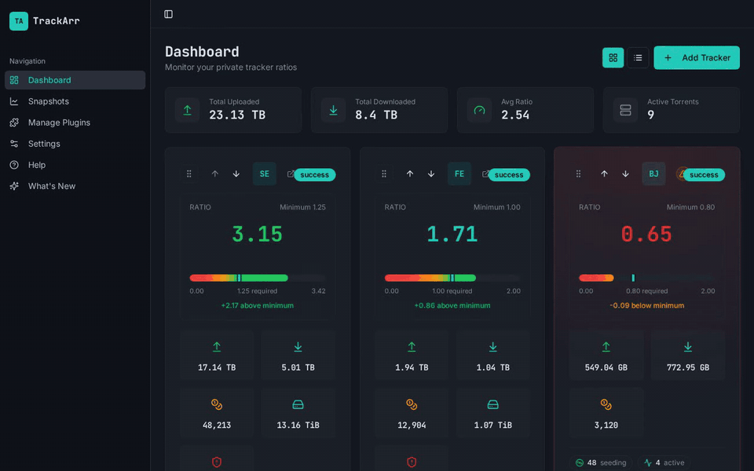
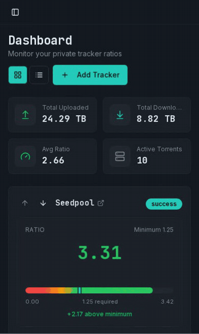
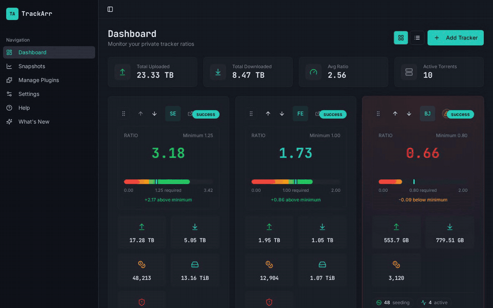
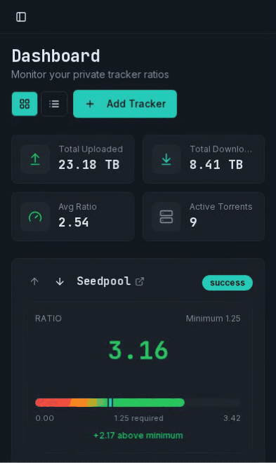
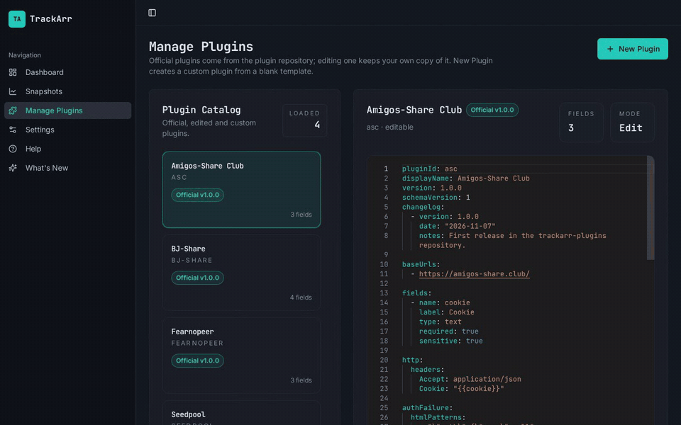
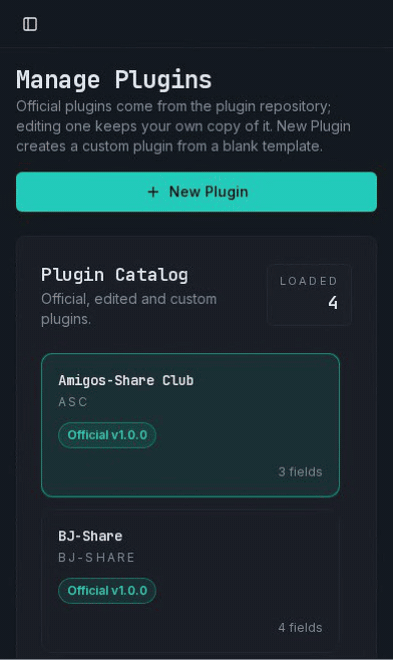

# TrackArr

| Status | Badge |
| --- | --- |
| CI pipeline | [](https://github.com/leandrobattochio/trackarr/actions/workflows/ci.yml) |
| Cypress E2E | [](https://github.com/leandrobattochio/trackarr/actions/workflows/full-stack-e2e.yml) |
| Frontend coverage (`frontend/`) | [](https://app.codecov.io/github/leandrobattochio/trackarr?flags%5B0%5D=frontend) |
| Backend coverage (`backend/`) | [](https://app.codecov.io/github/leandrobattochio/trackarr?flags%5B0%5D=backend) |

TrackArr is a self-hosted dashboard for private tracker monitoring. It lets you register tracker integrations, sync stats manually or on a schedule, keep historical snapshots, and define new tracker connectors through YAML instead of hard-coded backend logic.

The full documentation is in the **[wiki](https://github.com/leandrobattochio/trackarr/wiki)**.

## A look around

The GIFs below run on fictional demo data.

### Dashboard

Totals across every tracker, and one card per tracker with its ratio against the required minimum, its stats and quick actions. A tracker below its minimum ratio is highlighted. The toggle switches to a compact list, and both views can be reordered.

<table>
  <tr>
    <th>Desktop</th>
    <th>iPhone</th>
  </tr>
  <tr>
    <td></td>
    <td></td>
  </tr>
</table>

### Snapshots

The history of every tracker: uploaded and downloaded data, ratio and torrent activity over time.

<table>
  <tr>
    <th>Desktop</th>
    <th>iPhone</th>
  </tr>
  <tr>
    <td></td>
    <td></td>
  </tr>
</table>

### Manage Plugins

The plugin catalog and the YAML editor, with validation, completions and a **Test** button that dry-runs a plugin with an integration's settings.

<table>
  <tr>
    <th>Desktop</th>
    <th>iPhone</th>
  </tr>
  <tr>
    <td></td>
    <td></td>
  </tr>
</table>

## Quick start

TrackArr runs as a single container and keeps its data in a SQLite file in the data volume:

```yaml
services:
  trackarr:
    image: ghcr.io/leandrobattochio/trackarr:v0.5.4
    container_name: trackarr
    restart: unless-stopped
    ports:
      - "3012:3000"
    environment:
      ASPNETCORE_ENVIRONMENT: Production
      Hangfire__Directory: /data
      Data__Directory: /data
      APP_TIMEZONE: America/Sao_Paulo
      TZ: America/Sao_Paulo
    volumes:
      - /mnt/user/appdata/trackarr:/data
```

Adjust the volume path, port, timezone and image tag to your setup. [Installation](https://github.com/leandrobattochio/trackarr/wiki/Installation) covers the rest, [Configuration](https://github.com/leandrobattochio/trackarr/wiki/Configuration) lists every setting, and [Using PostgreSQL](https://github.com/leandrobattochio/trackarr/wiki/Using-PostgreSQL) explains how to keep the data in PostgreSQL instead.

Upgrading? Read [Upgrading](https://github.com/leandrobattochio/trackarr/wiki/Upgrading) first: v0.4 deleted every v0.3 plugin file, and v0.5 keeps an existing PostgreSQL setup as it is.

> [!WARNING]
> The trackarr API and UI have **no authentication**. Anyone who can reach the port can read and change your integrations and plugins, and a changed plugin can send your stored tracker cookies and API keys to any host. Keep trackarr on a trusted network (LAN or VPN) and never publish it to the internet. If you need remote access, put it behind a reverse proxy or VPN that authenticates users.

## Features

- Dashboard with totals and a card or a list row per tracker: ratio against the required minimum, uploaded, downloaded, seed bonus, buffer, hit and runs and torrent counts
- Manual sync, and recurring sync per integration from a cron expression
- Optional HTTP, SOCKS4 or SOCKS5 proxy per tracker, for trackers that must be reached through one
- Snapshot history with charts
- Official tracker plugins downloaded from [`trackarr-plugins`](https://github.com/leandrobattochio/trackarr-plugins) on every start, so tracker fixes arrive without a new image
- Official plugins you can edit (your copy is kept as an override) and custom plugins, in an editor with validation, completions and a **Test** dry run
- What's New with the trackarr and plugin changelogs
- One container with the React frontend served by ASP.NET Core, and SQLite by default with PostgreSQL as an option

## Documentation

- [Installation](https://github.com/leandrobattochio/trackarr/wiki/Installation): Docker Compose, building the image, data storage and backups
- [Configuration](https://github.com/leandrobattochio/trackarr/wiki/Configuration): every setting and environment variable
- [Proxies](https://github.com/leandrobattochio/trackarr/wiki/Proxies): reaching a tracker through an HTTP or SOCKS proxy
- [Using PostgreSQL](https://github.com/leandrobattochio/trackarr/wiki/Using-PostgreSQL): the optional PostgreSQL database
- [Plugins](https://github.com/leandrobattochio/trackarr/wiki/Plugins): official, override and custom plugins, and the plugin YAML
- [Upgrading](https://github.com/leandrobattochio/trackarr/wiki/Upgrading): what changes between versions
- [Development](https://github.com/leandrobattochio/trackarr/wiki/Development): architecture, running from source, tests
- [API](https://github.com/leandrobattochio/trackarr/wiki/API): the HTTP endpoints

To fix a tracker plugin or add a new one, see the [`trackarr-plugins` contributing guide](https://github.com/leandrobattochio/trackarr-plugins/blob/main/CONTRIBUTING.md).
